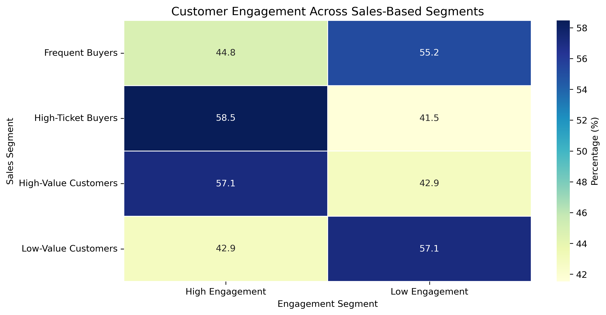
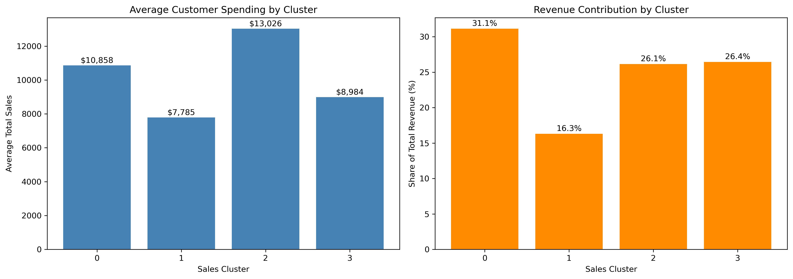
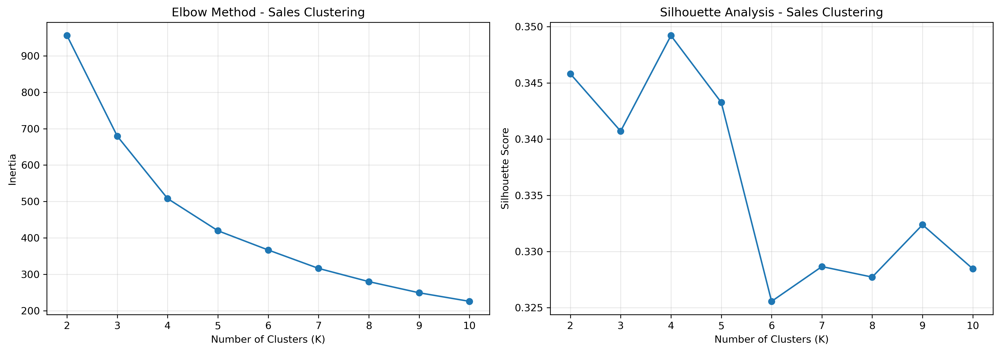
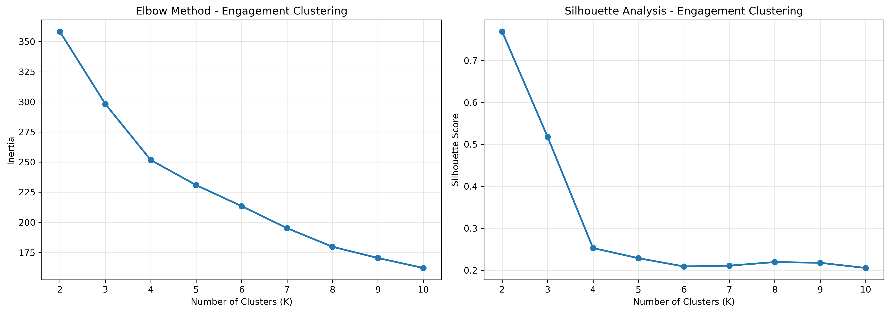

# E-Commerce Customer Segmentation: Sales & Engagement Analytics

**An exploratory machine learning project using K-Means clustering to connect customer purchasing value with digital engagement.**

## Overview

Customer value and customer engagement are related, but they are not interchangeable. This project analyzes **795 e-commerce customers** and develops two complementary segmentation models: one focused on purchasing behavior and one on engagement. It then cross-tabulates the results to identify actionable customer profiles.

The analysis began with a combined-feature clustering approach. Profiling revealed that the initial segments differed mainly in browsing and add-to-cart behavior, rather than purchasing value. Instead of discarding that finding, I used it to refine the business question and build two separate, more interpretable segmentation models.

## Business Questions

- Which customer groups contribute the most revenue and demonstrate the highest purchasing value?
- Which customers show high versus low digital engagement?
- How does engagement vary across purchasing segments?
- What targeted marketing or retention hypotheses could be tested for each segment?

## Data and Features

The analysis uses **795 customer records**. The two final models use different feature sets:

| Model | Clustering features | Selected number of clusters |
|---|---|---:|
| Sales-based | `Total_Sales`, `Avg_Order_Value` | 4 |
| Engagement-based | `Avg_Browsing_Time`, `Like_Rate`, `Share_Rate`, `Add_to_Cart_Rate` | 2 |

`Total_Orders` is also examined in sales exploratory analysis and used to interpret sales segments. It is not included in the final sales clustering feature set because of its high correlation with `Total_Sales` (approximately **0.96**).

## Methods

1. Inspect customer-level features and check missing values.
2. Examine descriptive statistics and feature correlations.
3. Standardize clustering inputs using `StandardScaler`.
4. Compare candidate cluster counts using inertia (elbow method) and silhouette scores.
5. Fit separate K-Means models for sales and engagement.
6. Profile clusters using original-scale customer metrics, customer counts, and revenue contributions.
7. Cross-tabulate sales and engagement segments and translate findings into business hypotheses.

**Tools:** Python, pandas, NumPy, scikit-learn, Matplotlib, Seaborn, Jupyter Notebook.

## Key Results

| Model | Clusters | Silhouette score | Interpretation |
|---|---:|---:|---|
| Engagement | 2 | **0.769** | Strong separation in the selected engagement features |
| Sales | 4 | **0.349** | More overlapping, exploratory purchasing profiles |

### Sales-Based Customer Profiles

| Segment | Customers | Average total sales | Average orders | Average order value | Share of total revenue |
|---|---:|---:|---:|---:|---:|
| Frequent Buyers | 230 | 10,857.65 | 71.85 | 151.30 | 31.13% |
| Low-Value Customers | 168 | 7,784.85 | 53.48 | 145.76 | 16.30% |
| High-Value Customers | 161 | 13,026.27 | 79.55 | 164.11 | 26.14% |
| High-Ticket Buyers | 236 | 8,983.60 | 54.94 | 163.59 | 26.43% |

Segment names are **descriptive labels assigned after clustering**, not supervised-learning predictions. Revenue share reflects each segment's contribution to the observed dataset, while average total sales reflects average observed spending per customer.

### Engagement Within Sales Segments

| Sales segment | High engagement | Low engagement |
|---|---:|---:|
| Frequent Buyers | 44.78% | 55.22% |
| High-Ticket Buyers | 58.47% | 41.53% |
| High-Value Customers | 57.14% | 42.86% |
| Low-Value Customers | 42.86% | 57.14% |

**Key insight:** Purchasing behavior and digital engagement offer complementary views. For example, a majority of frequent buyers fall in the low-engagement group, while a majority of high-value and high-ticket buyers fall in the high-engagement group.

## Business Applications

- **High-value customers:** Test personalized loyalty benefits and retention initiatives.
- **High-ticket buyers:** Test premium recommendations and relevant cross-selling offers.
- **Frequent buyers:** Investigate ways to improve digital engagement without disrupting established purchasing habits.
- **Low-value customers:** Test product discovery and targeted offers to assess potential for increased purchasing activity.

These are **testable business recommendations**, not demonstrated causal effects.

## Limitations

- The four sales clusters have a modest silhouette score (**0.349**); boundaries may overlap.
- Several engagement features are highly correlated (approximately **0.89–0.94**), potentially giving related behavior multiple contributions to Euclidean distance.
- K-Means favors compact, distance-based clusters and may miss more complex structures.
- This observational segmentation cannot establish that engagement causes higher sales.
- The project does not validate the proposed marketing interventions through experiments.

Potential extensions include testing alternative clustering methods, incorporating recency and customer tenure when available, and evaluating marketing actions with A/B tests.

## Repository Structure

```text
.
├── README.md
├── E-Commerce_Customer_Segmentation_Using_K-Means_Clustering10.ipynb
└── figures/                 # Optional exported notebook charts
```

> Replace the notebook filename above with the exact uploaded filename if it differs. The notebook and figures must be added separately; this README does not contain them.

## How to Run

1. Clone or download the repository.
2. Create a Python environment with `pandas`, `numpy`, `scikit-learn`, `matplotlib`, `seaborn`, and `jupyter`.
3. Place the dataset at the path expected by the notebook, or update its data-loading cell.
4. Launch Jupyter and run the notebook from top to bottom.

```bash
pip install pandas numpy scikit-learn matplotlib seaborn jupyter
jupyter notebook
```

**Reproducibility note:** The dataset's source, license, and exact input filename should be documented before public release. Check the notebook for local absolute file paths and personal information before uploading.

## What I Learned

The most valuable part of this project was recognizing that a technically valid clustering solution did not fully answer the original business question. By examining cluster profiles and revisiting feature selection, I turned one broad segmentation into two focused analyses and then connected them to form more useful customer insights.

---

*Exploratory portfolio project. Results describe this dataset and should not be generalized without further validation.*

## Project Visualizations

### 1. Customer Engagement Across Sales Segments


### 2. Customer Spending and Revenue Contribution


### 3. Sales Clustering Evaluation


### 4. Engagement Clustering Evaluation


## Key Findings

- **Engagement segmentation:** K-Means identified two well-separated customer groups (Silhouette Score: 0.769).
- **Sales segmentation:** Four customer segments were identified (Silhouette Score: 0.349), indicating moderate-to-weak cluster separation.
- **High-value customers:** The highest-spending segment averaged approximately $13,026 in total sales per customer.
- **Revenue contribution:** Frequent Buyers generated the largest share of total revenue (31.13%).
- **Cross-segmentation:** High-Ticket Buyers and High-Value Customers showed higher proportions of highly engaged customers (58.47% and 57.14%, respectively).

These findings support a two-dimensional customer segmentation strategy that considers purchasing behavior and digital engagement separately.
